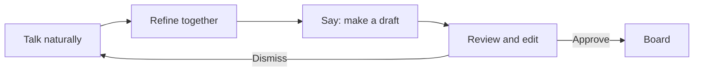

# Loose Ends

**A voice-first planning companion that turns a real conversation into an editable plan you can actually follow.**

Loose Ends is a local, single-user web application. Talk through an unfinished thought, refine it conversationally, ask the companion to make a draft, review the details, and approve only what should reach your board.

## The experience

The app is one responsive interface at `http://127.0.0.1:7861` with three persistent views:

- **Talk** — a voice-only conversation with natural turn-taking, spoken replies, and interruption.
- **Review** — editable draft title, description, dates, suggested steps, source context, approve/dismiss.
- **Board** — approved tasks, ideas, ordered steps, and explicit completion/cancellation.

The important boundary is intentional: conversation does not silently create tasks. When the plan sounds right, say **“make a draft.”** You can keep speaking to revise that draft—“actually, change it to Friday”—before opening Review. The Review badge appears, ending the conversation opens the current draft, and approval adds it to the Board.



## What runs where

| Layer | Implementation | Responsibility |
|---|---|---|
| Product UI | Vite + plain JavaScript/CSS | Talk/Review/Board shell, LiveKit client, voice session state, room audio playback |
| Real-time transport | LiveKit | WebRTC room, bidirectional audio, agent dispatch, hidden response stream |
| Voice intelligence | Python LiveKit agent + Groq | Whisper speech-to-text, OSS 20B conversation/planning, Orpheus speech |
| Local web/API | FastAPI | Static UI, private token creation, draft and board endpoints |
| Business rules | Plain Python services | Validation, bounded planning, approval, task/step state |
| Storage | SQLite | Durable proposals, approved work, and progress |

LiveKit is the real-time transport rather than the speech model. Groq Whisper privately transcribes a completed turn, OSS 20B reasons, and Groq Orpheus turns the reply into audio that the agent publishes into the LiveKit room. Conversation text is never rendered in Talk. The browser only plays WebRTC audio, so the experience does not depend on an installed system voice.

## Local setup

### 1. Install Python dependencies

```bash
python3 -m venv .venv
source .venv/bin/activate
pip install -r requirements.txt
```

### 2. Configure the local environment

```bash
cp .env.example .env
```

Set these values in `.env`:

```dotenv
GROQ_API_KEY=
LIVEKIT_URL=wss://your-project.livekit.cloud
LIVEKIT_API_KEY=
LIVEKIT_API_SECRET=
```

The defaults use `whisper-large-v3-turbo`, `openai/gpt-oss-20b`, and `canopylabs/orpheus-v1-english` with the `autumn` voice. Secrets remain in local Python processes and are never compiled into the browser assets.

### 3. Build the browser interface once

```bash
cd voice-ui
npm install
npm run build
cd ..
```

### 4. Start the two local processes

Terminal 1 — unified web application:

```bash
source .venv/bin/activate
python app.py 2>&1 | tee -a data/logs/main-app.log
```

Terminal 2 — LiveKit voice agent:

```bash
source .venv/bin/activate
python -m loose_ends.voice_agent start 2>&1 | tee -a data/logs/voice-agent.log
```

Open [http://127.0.0.1:7861](http://127.0.0.1:7861). There is no second page or iframe to open.

## First conversation

1. Press **Start talking** and allow microphone access.
2. Describe the loose end and answer or correct the companion naturally.
3. Say **“make a draft”** when the proposed plan feels useful.
4. Keep refining by voice if needed; explicit corrections revise that same pending draft.
5. Press **End conversation**; the app opens Review when the draft exists.
6. Inspect it, select **Approve & add to board**, then track it from Board.

If you end without a draft, the app stays on Talk and explains what to do. Review and Board are always reachable from the header.

## Current guarantees and limits

- Short, single-speaker English conversations are the initial target.
- Whisper is segment-based: the agent understands a turn after a short pause rather than continuously while words are still being spoken.
- Every proposal remains editable and requires approval.
- Repeated approval does not create a duplicate task.
- Unknown dates remain blank and unresolved details stay visible.
- The app does not schedule reminders, send messages, operate a calendar, or change external services.
- Groq Orpheus currently limits each TTS request to 200 characters, so the agent keeps spoken sentences concise.
- Talk has no typed fallback or visible transcript; microphone access and WebRTC audio playback are required.
- The default server binds to loopback; do not expose it publicly without authentication and a security review.

## Verification

```bash
python -m unittest discover -s tests -v
curl http://127.0.0.1:7861/api/health
```

If a provider call fails, persisted data remains available for retry. Runtime logs are kept under `data/logs/`, which is ignored by Git. Each voice room also writes a private diagnostic transcript to `data/logs/conversations/<room-name>.jsonl`, including user/agent messages, speech events, and draft-tool outcomes. This stays local and is never rendered in the voice UI; delete it whenever you no longer need it for debugging.

## Product and engineering documents

- [Voice-first frontend decision](docs/frontend-decision.md)
- [Architecture and runtime flow](docs/architecture.md)
- [Implemented UI plan](docs/wireframes.md)
- [Local run and test guide](docs/local-preview.md)
- [Backend contracts](docs/contracts.md)
- [Product scope and acceptance criteria](docs/product-scope.md)
- [Delivery plan](docs/delivery-plan.md)

The former Gradio/iframe direction is retired. The voice interface built on 17 November 2026 is now the product baseline; Python services and SQLite were retained underneath it.
