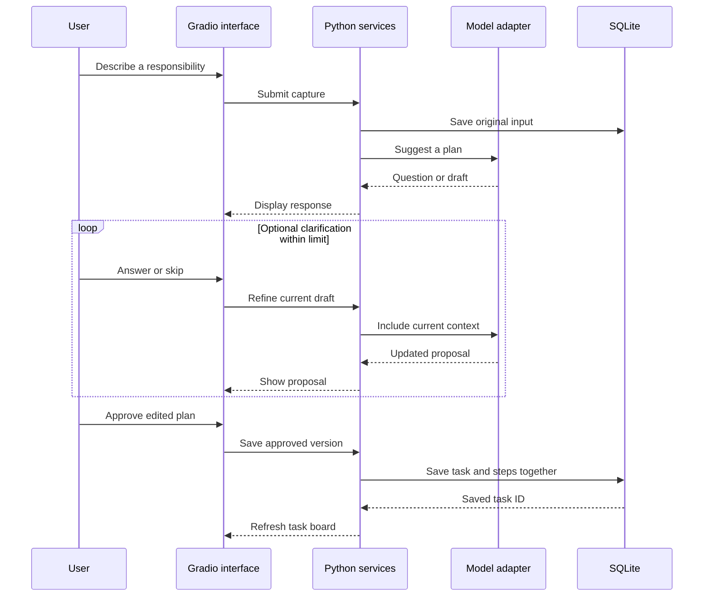

# Loose Ends

**A personal planning companion that turns spoken thoughts into clear tasks, manageable steps, and a plan you can follow.**

Built toward the Kane CLI online hackathon, with a longer-term goal of a useful personal productivity application.

## The problem

Commitments arrive as spoken thoughts, pasted messages, and half-formed plans. Turning them into useful tasks takes more than writing a title: you need to understand what finishing means, identify the essential steps, and decide when to work on them.

An assistant can also get this wrong: suggesting an unsuitable date or time to revisit a task, losing a correction or cancellation, creating duplicates, or acting on something you only mentioned as an idea.

Loose Ends keeps the original context and helps you shape a plan before you approve it. Its longer-term ambition is to become a supportive personal companion: an alter ego that helps you reflect on what happened, consider what you could do differently next time, and follow through without adding pressure.

## What the app does

The bot stays available on the home screen alongside your task board. You can speak or type a thought, clarify a responsibility, ask about upcoming work, or revisit an existing plan.

The assistant asks focused follow-up questions when a task is vague, suggests the essential substeps, and helps fit those steps into the time available. You can ask for fewer questions or skip optional clarification. Missing information stays visible rather than becoming an invented commitment.

You review proposed tasks, steps, and dates before saving them. The task board belongs to this application. The bot works through the application's own backend; computer-use agents and external browser runners are outside the product scope.

## Example

> “Send the proposal to Alex tomorrow. Compare hosting options this weekend. Maybe try a new note-taking app, but don’t make that a task.”

Loose Ends proposes two tasks and saves the last thought as an idea. It may ask whether the proposal is already drafted and what matters most in the hosting comparison. You can answer, skip the question, or request a simpler plan.

For the proposal, it might suggest reviewing the draft, checking attachments, and sending it. For the comparison, it might suggest choosing criteria, comparing a few options, and recording a decision. These are editable suggestions, not assumed facts about your work.

The bot asks for a concrete date or time where needed, while distinguishing a deadline from a suggested work session. It shows the original words supporting each task. Once approved, tasks and their steps appear on the board. Creating a “send proposal” task does not send anything.

Later, you can ask, “What should I focus on next?” or “What do I still need to do for the proposal?” The assistant answers using your saved plan and recorded progress. Adaptation to your preferred working style is a later extension.

## From thought to saved plan

## Capabilities and AI responsibilities

“Agent” below describes a responsibility. Initially, one model and a few focused functions can fulfil these roles; they do not need separate services or a multi-agent framework.

| Stage | First working version | AI role | Later expansion |
|---|---|---|---|
| Capture | Browser recording, editable transcript, typed or pasted text | Speech recognition model; no autonomous agent needed | Audio uploads, screenshots, documents |
| Understand | Separate tasks from ideas; preserve corrections and cancellations; propose dates | Intake assistant | Recurring commitments and richer context |
| Clarify | Ask focused questions; allow skipping or fewer questions | Conversation assistant | Remember preferred clarification style |
| Plan | Suggest a short sequence of essential steps; let the user edit it | Planning assistant | Dependencies, effort estimates, and scheduling suggestions |
| Review | Approve, edit, or dismiss tasks and steps; show source context | Assistant explains proposals; backend saves approved changes | More detailed plan comparisons |
| Task board | Save tasks, steps, ideas, dates, and completion state | Ordinary application logic | Priorities, recurring tasks, and dependable reminders |
| Home-screen companion | Answer questions about saved tasks and progress | Task-aware conversation assistant | Personalised coaching and reflection |
| Integrations | Internal application operations only | No external-action agent in the MVP | Approved API-based calendar or task operations |
| Development verification | Kane tests meaningful flows and returns results to the coding agent | Coding agent plus a separate Kane integration | Broader regression checks and CI integration |

The backend validates model output and applies changes. The assistant must not invent progress, silently change approved plans, or imply that a reminder was scheduled when no reminder service exists.

## Delivery phases

### Phase A — capture, clarify, plan, and organise

Build one complete journey: capture → clarify → propose steps → review → save to the internal task board. Keep the bot available for questions about the saved plan.

The first version supports short, single-speaker English notes, explicit recording start/stop, one level of subtasks, optional dates, and simple completion tracking. Clarification can start with one focused question at a time. Plans can be ordered checklists; automatic scheduling is not required.

Use a single-user local setup first. A shared or public deployment needs appropriate access control. Keep failure messages and retry behaviour understandable, and prevent repeated approvals from creating duplicate tasks.

### Phase B — assist with updates and follow-through

Extend the same bot and internal board so users can ask it to revise a plan, propose new priorities, or reschedule steps. Review proposed changes before applying them. Add reliable reminders when a scheduling and notification mechanism is ready.

This phase continues to use application APIs and backend functions. It does not introduce computer-use agents.

### Longer-term direction

- OAuth-based connections, where users authorise access to supported services.
- Calendar integration to compare planned work with available time.
- Android/iOS app-usage signals, subject to platform permissions and feasibility. This requires separate investigation and is not promised as a browser-only feature.
- User-controlled working-style preferences: how much prompting, detail, encouragement, and structure the bot provides. Start with explicit preferences; model fine-tuning is a later possibility, not a prerequisite.
- Gamification that rewards consistent tracking and follow-through, with controls to reduce pressure.
- Reflection based on recorded activity: what worked, what slipped, and how the next plan could improve.

## A simple starting stack

**Selected for Phase A: Gradio Blocks, plain Python application services, SQLite, and Groq model adapters.** See the [frontend decision](docs/frontend-decision.md) for the comparison and trade-offs.

| Module | Starting implementation | Why |
|---|---|---|
| Bot interface and task board | Gradio Blocks with chat, microphone input and review controls | Reuse input components and explicit event handlers |
| Backend system | Plain Python services called by event handlers | Keep task rules independent of the UI framework |
| Data storage | SQLite and local audio files | Minimal setup for one running application |
| Model access | Small provider adapters; Groq initially | Allows local inference later without rewriting task logic |
| Verification | Separate Kane scripts/configuration | Keeps the product independent of Kane availability |

Pranav can lead transcription, prompting, and evaluation. A backend colleague can lead API contracts, data integrity, failure handling, and deployment; these responsibilities transfer from Java experience. This proposal does require the colleague to work in Python initially. If Java is essential, choose a single Java backend together before implementation rather than starting with two backend services.

Keep modules separate in the code while running them in one application. Start with a visible “processing” state and bounded model calls through Gradio event handlers. Gradio session state holds temporary UI selections; SQLite holds recoverable drafts and approved tasks. Use the built-in event queue for responsiveness, not as durable job storage. Persist each capture before processing so it can be retried. Introduce a background worker only when measured latency or recovery needs justify it.

## Credentials and model choices

Groq is the initial proposed provider for speech transcription and structured action extraction. A local alternative can use faster-whisper and Ollama. Exact models remain configurable and should be checked during setup.

Browser recording needs microphone permission but no paid API key. Provider secrets stay in backend configuration and out of Git. OAuth credentials become relevant only when external integrations are implemented.

Kane/TestMu credentials belong to the development verification setup. Kane must be modular and optional for running the application: expiring credits should not disable capture, the bot, or the task board. During the hackathon, meaningful Kane results still need to feed back to the coding agent as part of development.

## Project documents

**This README is the approved product direction. The documents below have been aligned to it; implementation is still pending.**

- [Product scope and acceptance criteria](docs/product-scope.md)
- [Architecture and diagrams](docs/architecture.md)
- [Frontend decision and sources](docs/frontend-decision.md)
- [Local Markdown preview](docs/local-preview.md)
- [API and data contracts](docs/contracts.md)
- [Delivery plan and team split](docs/delivery-plan.md)
- [Open decisions](docs/review-checklist.md)
- [Hackathon requirements and sources](docs/hackathon.md)
- [Initial evaluation cases](tests/evals/cases.json)

The architecture explains modules through “problem → requirement → solution” and includes wireframes for the bot interface and task board.

## Running it

The repository currently contains design documents and evaluation examples. Application code and a runnable Kane suite have not been implemented. The implementation goal is a documented, simple startup process and a working demo that reviewers can access without downloading local model weights.

## Review before implementation

The companion-and-task-board direction and simple starting stack are approved. Review the detailed contracts, wireframes, and remaining implementation choices together. Keep names, deadlines, and personal recordings out of example data. License and repository visibility remain decisions for the team.
