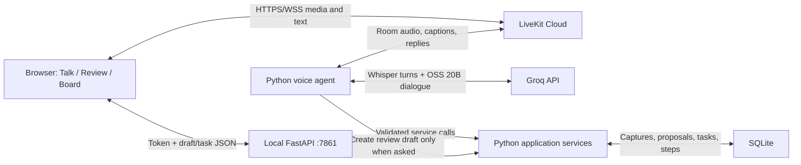
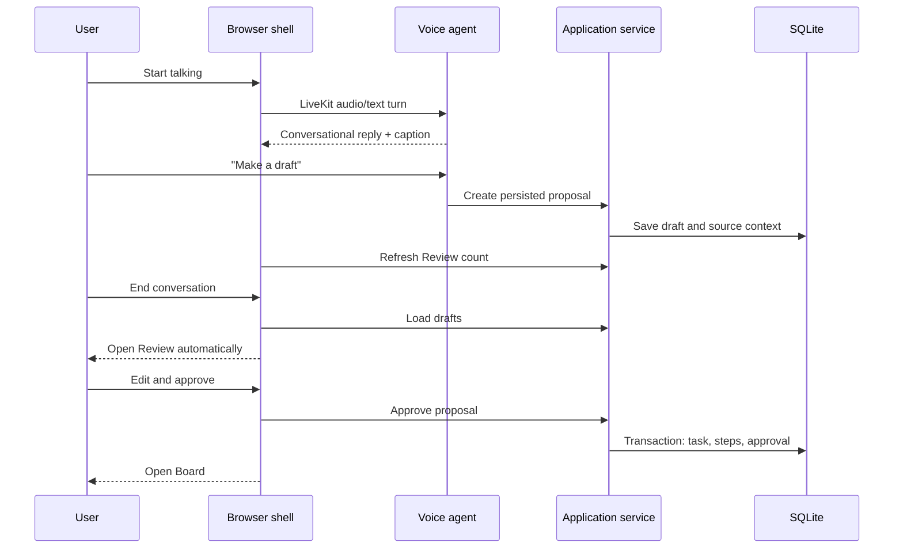

# Architecture — voice-first local application

This document describes the implemented direction as of 17 November 2026. The browser has one product shell; Talk, Review, and Board are views within it rather than separate websites.

## Runtime shape

Two local processes are required:

- `python app.py` serves the UI and local API on port 7861.
- `python -m loose_ends.voice_agent dev` joins dispatched LiveKit rooms and runs the conversation.

LiveKit transports real-time media and text; it is not the speech or reasoning model. Groq provides Whisper speech-to-text and OSS 20B reasoning. Final agent text returns through LiveKit, and browser speech synthesis speaks it locally.

## Product journey

The model may discuss and refine freely, but it creates a persisted proposal only after an explicit drafting request. A proposal is not a task. Approval is the boundary that creates board state.

## Modules and responsibilities

| Module | Responsibility |
|---|---|
| `voice-ui/` | Responsive shell, Talk/Review/Board navigation, LiveKit browser client, transcript, browser speech, API rendering. |
| `voice_server.py` | Static files, health/token routes, review and board JSON routes; no business rules in the browser. |
| `loose_ends/voice_agent.py` | Turn detection, Groq Whisper, OSS 20B conversation, and explicit draft-creation tools. |
| `loose_ends/services.py` | Validation, proposal lifecycle, approval idempotency, task and step state. |
| `loose_ends/database.py` | SQLite schema and transactional connections. |
| `loose_ends/groq_adapter.py` | Structured planning and task-aware model requests used by application services. |

## UI state model

Talk is the default route. Navigation uses `#talk`, `#review`, and `#board`, so reloads preserve the current place without requiring server-side routes.

- **Talk** keeps ephemeral transcript and LiveKit room state in the browser.
- **Review** always reloads durable draft proposals from `/api/review`.
- **Board** always reloads durable tasks and steps from `/api/board`.
- The Review badge and Talk handoff card are derived from the same proposal list.
- Ending a room refreshes proposals; Review opens when at least one exists.
- If no draft exists, the Talk view remains visible and explains that the user should say “make a draft” next time.

## Data and safety boundaries

Captures, proposals, tasks, and steps live in SQLite. Approval writes the task, ordered steps, receipt, and proposal status in one transaction. A unique proposal-to-task relationship makes repeat approvals safe. Missing dates remain missing; the model must not invent completion or claim an external action happened.

The local token endpoint signs short-lived, opaque LiveKit identities. Provider and LiveKit secrets stay in `.env` and server processes. The app binds to loopback by default. A public deployment requires access control, secure cookies/tokens, TLS, per-user ownership, and a review of audio retention.

## Failure behaviour

| Failure | Expected experience |
|---|---|
| Voice setup missing | Start shows a clear configuration message; Review and Board remain usable. |
| Agent slow to join | Composer says it is waiting; connection state stays visible. |
| Groq turn fails | Agent explains the failure; the room can continue or be restarted. |
| Draft refresh fails | Existing conversation remains; a toast reports the local API error. |
| Approval conflicts | No duplicate is created; Review reports the conflict and reloads. |
| Browser speech unavailable | The assistant reply remains visible as text. |

## Growth triggers

| Trigger | Change to consider |
|---|---|
| Several users or public access | Authentication, per-user records and rooms, PostgreSQL. |
| Work must continue after process exit | Durable job queue and processing-status API. |
| Interim word captions are essential | True streaming STT provider behind the same LiveKit agent. |
| Browser voice is not good enough | Dedicated streaming TTS with interruption support. |
| External calendar/task actions are added | OAuth, explicit proposed-change review, and integration audit log. |

The retired Gradio UI and dependency have been removed and are not part of this diagram.
