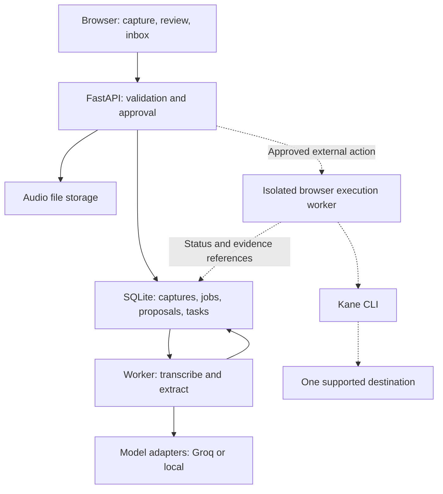
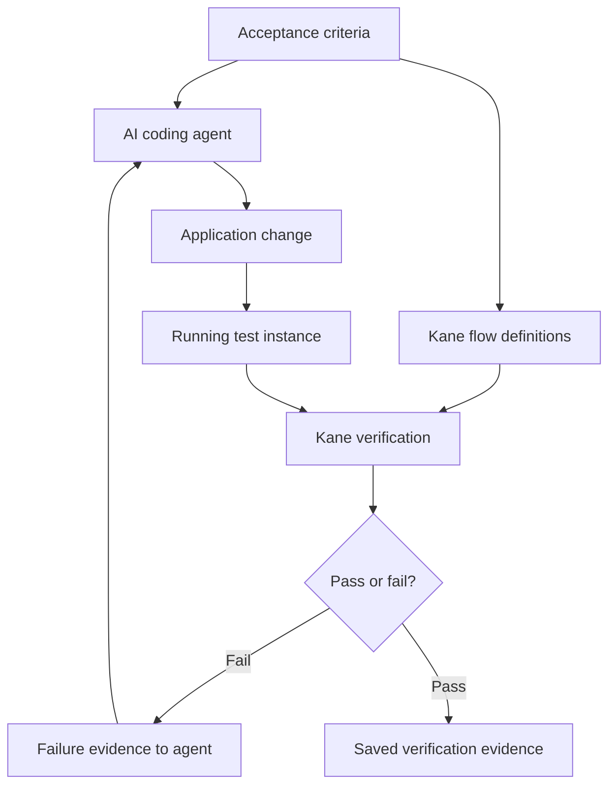

# Architecture

Proposed design, not implemented. Solid edges describe the core; dashed edges describe the conditional external-action extension.

## Product runtime

The UI polls job status initially. The API never waits synchronously for an entire audio pipeline. One worker claims persisted jobs; atomic claims and attempt limits prevent concurrent duplicate processing. SQLite is appropriate for the single-instance prototype, not a proposed high-concurrency service.

## Development verification loop

This loop is required even if runtime browser execution is deferred. Use a controlled change-triggered verification command or hook, bounded repair attempts, and stored evidence. Do not run an unbounded agent loop on every file save. Agree the exact Kane commands/output contract after the initial tool spike; no integration is implemented in this repository.

## State and correctness

- Capture: received → queued → transcribing (audio only) → extracting → ready; failures retain the input and error stage.
- Proposal: pending → approved or dismissed. Transcript edits supersede pending proposals by revision.
- External execution: pending approval → queued → running → succeeded / failed / unknown / authentication needed.
- Application-level idempotency covers approvals and job submission. External browser writes are not guaranteed exactly once: an uncertain result requires reconciliation.
- Dates store the original phrase, interpreted value, timezone, and ambiguity. Date-only tasks stay date-only; do not invent midnight deadlines.
- Validate JSON structure and meaning separately. Do not let model output choose arbitrary URLs, shell commands, or browser steps.

## Boundaries

Browser: recording and review only; no provider keys. API: user/session checks, typed validation, transactional writes. Worker: bounded model calls, timeouts, retries, and minimal diagnostic metadata. Optional browser worker: approved, allowlisted actions and isolated authenticated sessions.

Use synthetic data for a public demo. Personal deployment needs authentication and owner-scoped reads/writes. Keep recordings and transcripts out of routine logs. Persist model version, extraction prompt version, timings, and error codes for evaluation. Retention policy is a review decision.

## Local and hosted deployment

Local: browser + API + worker + SQLite/audio files on one computer; Groq or local inference. Local model performance must be benchmarked on the actual machine.

Hosted demo: HTTPS frontend/API, persistent storage, accessible worker, and configured model provider. In-memory jobs and ephemeral audio storage are insufficient. Judges should not need to download models. Provide a recorded fallback for provider downtime and label any fixture replay as replay, not live inference.

## Extension path

Replace SQLite with PostgreSQL and files with object storage when deploying multiple instances. Add a durable queue when worker throughput/recovery needs justify it. Provider adapters allow local/cloud comparisons without rewriting the product. Runtime integrations remain separate from the coding-agent verification loop.
