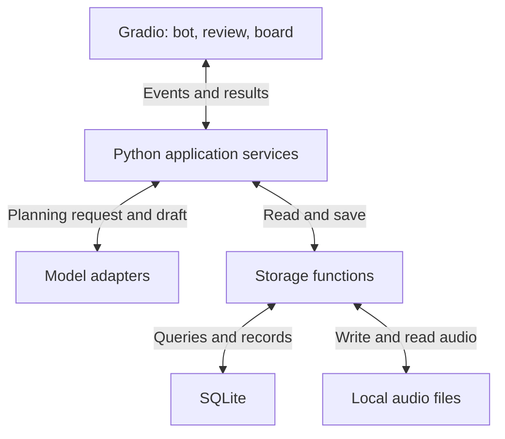
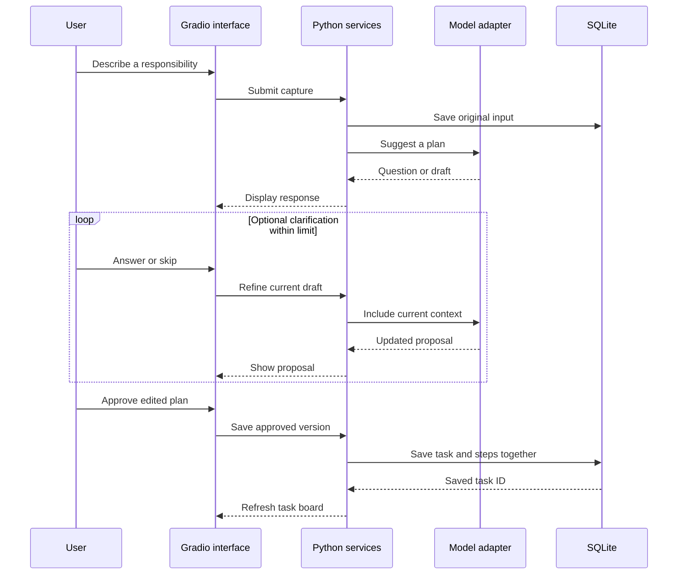
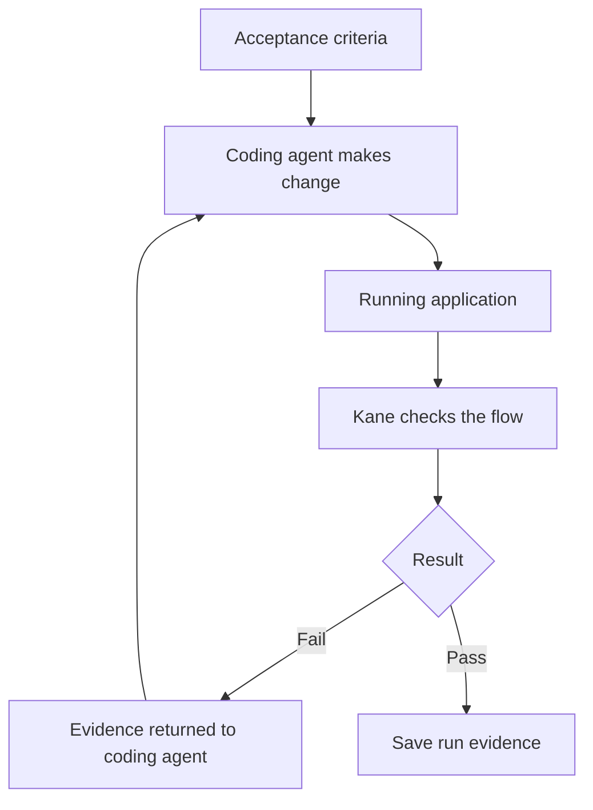

# Architecture — a guide for the first implementation

Based on the approved README. These are design decisions and proposed interfaces; the app is not implemented yet.

## One application, clear modules

Use one Gradio Blocks application, ordinary Python services, SQLite, and local audio files. The framework decision and alternatives are documented in [frontend-decision.md](frontend-decision.md). A module is a part of the code with a clear job, not a separate server. The colleague's backend experience applies to contracts, database design, errors, and deployment; the initial implementation remains Python.

| Problem | Requirement | Module and solution |
|---|---|---|
| Thoughts arrive before they are well formed | Accept voice/text and keep context | Bot interface: recorder, transcript editor, conversation |
| A task title is often too vague | Ask a useful question and suggest essential steps | Planning module: structured model calls, optional clarification |
| Suggestions may misrepresent intent | Let the user inspect changes first | Review interface: editable proposals with source excerpts |
| Tasks should survive closing the browser | Persist approved plans and progress | Task board + storage: tasks, ordered steps, ideas, dates |
| Retried clicks can save twice | Save approval only once | Backend: unique proposal IDs and one database transaction |
| Models can fail or produce invalid answers | Keep inputs and explain how to retry | Backend + model adapter: bounded calls and validated output |
| Users need to ask about saved responsibilities | Answer from actual saved tasks | Companion module: retrieve task context before answering |
| Verification credits can expire | Keep testing optional for app startup | Separate development-only Kane integration |

## Runtime diagram

Arrows below are labelled data exchanges. UI events call services; replies update controls. Files and databases do not initiate requests. A two-way edge represents read/write or request/response, not an autonomous loop.



The frontend is composed in Python with Blocks, not hand-written HTML templates. Event handlers call application functions directly; a separate REST service is not required for Phase A. API routes can be added later if another client needs them. Provider keys stay server-side.

## Capture, clarification and approval



Clarification is the deliberate iterative loop. A database response is simply a return value. Limit question rounds and allow skipping. UI drafts must carry the capture revision so delayed model responses cannot replace newer edits.

## Module walkthrough

### 1. Bot interface

Home contains a conversation pane and a compact view of upcoming tasks. Start/stop recording explicitly; pauses do not submit speech. Users can edit the transcript, type instead, skip a clarification, or select “Fewer questions.” Keep the bot accessible beside the task board on desktop and through a persistent Bot tab on mobile.

### 2. Planning and clarification

Take the transcript, capture time, timezone, and any clarification replies. Produce tasks versus ideas, an optional question, and a short list of proposed steps. Start with one focused question per round and a conservative question budget. Skipping a question produces a draft with missing information clearly marked.

One model can perform intake, planning, and conversation using separate functions/prompts. “Agent roles” describe responsibilities, not independently running processes. Suggested steps are visibly labelled as suggestions; only the task intent must have source evidence.

### 3. Plan review

Show titles, original words, proposed steps, deadline, and optional suggested work time separately. Allow editing, removing steps, approving, or dismissing each proposal. Unknown dates remain blank. Approval saves a snapshot; later transcript edits cannot silently rewrite the approved task.

### 4. Task board

Show open/completed tasks and a separate ideas section. A task opens to one level of ordered steps. Completing the final step prompts the user to mark the parent task complete rather than assuming it. A parent completed manually does not fabricate step completion. Cancellation is a distinct state, not deletion.

### 5. Backend system

Validate input, call planning functions, and store changes. A transaction means related changes either all save or none do. A revision number detects when the user is editing an old version. An idempotency key identifies a repeated request so it does not run the same save twice.

Persist the capture first, then process it in a bounded event handler. The UI shows “Processing.” A provider failure leaves the capture available for retry. Gradio’s event queue is not a durable task queue. Record attempt ID, revision and last-updated time; only the current attempt may save results. On restart, abandoned processing attempts become retryable failures. An uncertain browser response should trigger a status read before retrying.

Do not introduce an always-running worker yet. Add one if real measurements show unacceptable request duration or a need to continue processing after disconnects. That change would require a durable job queue and revised recovery behaviour.

### 6. Model adapters

An adapter is a small wrapper around a provider. Start with Groq for transcription and structured text generation. Later adapters may use faster-whisper or Ollama. Validate response structure and meaning: valid JSON does not prove the date or task is correct. Apply a bounded timeout and at most one repair attempt for malformed output.

### 7. Task-aware companion

For the first version, retrieve a bounded list of this user's tasks and steps directly from SQLite; embeddings are unnecessary. The bot may explain next steps and suggest a focus. It references task IDs and cannot claim a task is done unless its saved state says so. Chat requests to modify existing tasks produce a proposed change in Phase B, never a silent write.

## Development verification, separate from runtime



Keep configuration and commands in a future `verification/kane/` folder. Test actual Gradio controls with stable labels in the first slice; no framework choice guarantees Kane compatibility. The app must neither import Kane nor require its credentials. Select meaningful checks after a completed feature; avoid an unbounded repair loop. Ordinary backend tests continue to run when Kane is unavailable. Pin actual CLI commands only after checking the installed version and doing the first integration spike.

## Wireframes

See [wireframes](wireframes.md) for desktop home, review, and mobile board layouts. These are static design sketches, not screenshots of a working app.

## Growth without premature services

| Trigger | Change to consider |
|---|---|
| Requests exceed practical wait times | Durable worker and job status polling |
| Several instances need concurrent writes | PostgreSQL instead of SQLite |
| Deployment has ephemeral disks | Persistent volume or object storage for recordings |
| Gradio layout/event wiring blocks the desired workflow | Revisit NiceGUI or a dedicated web frontend; retain Python services |
| External service connection is needed | OAuth and an explicit API integration module |

First deploy one instance with persistent storage and HTTPS. Restrict personal data access; use synthetic captures for the shared demo. Audio retention, cleanup retries, and account design remain explicit review decisions. App-usage tracking requires platform-specific investigation beyond this web MVP.

## Approval retry and duplicate prevention

```mermaid
sequenceDiagram
    participant UI as Review interface
    participant S as Approval service
    participant D as SQLite
    UI->>S: Approve proposal with revision and request key
    S->>D: Check receipt and proposal version
    alt Already saved with same payload
        D-->>S: Existing task ID
        S-->>UI: Open existing task
    else New valid approval
        S->>D: Transaction: task, steps, receipt, approval
        D-->>S: Commit success
        S-->>UI: Saved task
    else Stale or conflicting payload
        S-->>UI: Reload current draft; no write
    end
```

## Task-aware chat

```mermaid
sequenceDiagram
    participant UI as Bot interface
    participant S as Conversation service
    participant D as SQLite
    participant M as Model adapter
    UI->>S: Ask about responsibilities
    S->>D: Read this user's relevant tasks and steps
    D-->>S: Current saved state
    S->>M: Question plus bounded task context
    M-->>S: Answer and referenced task IDs
    S-->>UI: Grounded answer; no task mutation
```

## Gradio implementation boundaries

Use Blocks rather than a chat-only Interface. Compose chat/capture, review, and board panels with explicit events. Start with selection plus an editor for one proposal at a time, and a compact editable steps table; avoid elaborate dynamic widget generation. Microphone submission uses Gradio Audio; its temporary upload must be copied to managed storage before the event ends. Verify format handling and size limits on target devices.

Keep capture/task IDs in per-session State, never global mutable user variables. State is not the database and must not be the only copy of work. Page reload reconstructs saved drafts and tasks from SQLite. Configure event concurrency explicitly; revision checks remain necessary even when UI buttons are disabled. Use async provider calls or appropriate offloading for blocking work. Do not expose a public demo containing personal data or unauthenticated mutation functions.
