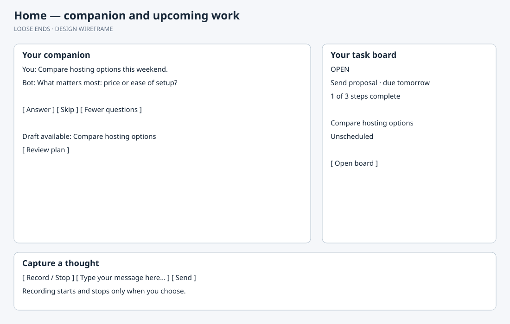
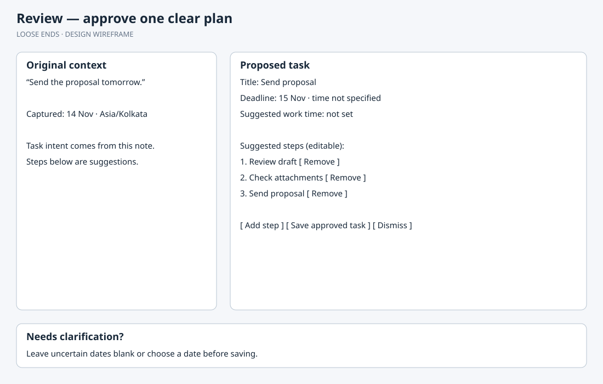
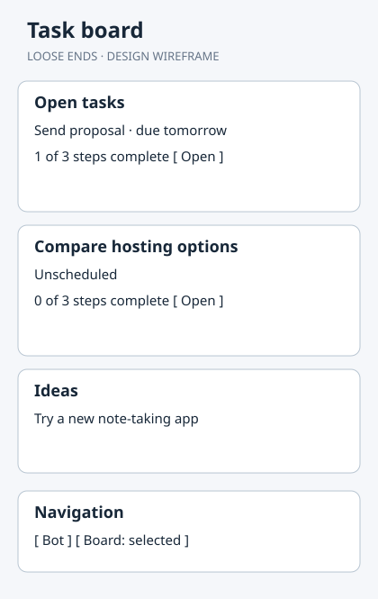

# Wireframes

Static sketches for implementation discussion, not a running product. Labels and example data are synthetic.

## Desktop home

Bot stays beside a task summary. Record has explicit start/stop states. Text input remains available if microphone permission is denied. “Review plan” opens suggestions; it does not create tasks directly. “Fewer questions” limits clarification rather than suppressing unresolved dates.

## Review a plan

Original words appear beside editable suggestions. Deadline and suggested work time are different. Steps are removable and clearly marked as AI suggestions. Approval applies to this proposal only; dismissed proposals do not enter the board. Saving and error states belong next to the approval button.

## Mobile task board

Persistent Bot/Board navigation keeps the companion reachable without covering the board. The initial board uses lists, not drag-and-drop. Opening a card shows ordered steps and original context if retained.

## Important states to implement

| State | User-facing behaviour |
|---|---|
| Empty | Explain capture and show one short example |
| Recording | Timer and Stop; no automatic submission on pauses |
| Processing | Keep input visible; disable duplicate submission |
| Clarification | Answer, Skip, or Fewer questions |
| Ambiguous date | Mark missing detail; let user choose or leave unscheduled |
| Provider failure | Input retained; clear Retry action |
| Stale draft | Explain newer version exists and reload it |
| Already approved | Open existing task instead of creating another |
| Saved | Confirm task/steps and link to board |

The wireframes cover normal paths; the table defines states designers and developers must add during implementation.

## Gradio interpretation

These sketches express content and navigation, not pixel-exact layouts. Use Blocks rows/columns for desktop and tabs/panels for narrow screens. The first implementation may show a task selector with a detail editor rather than custom cards. Keep chat reachable and review explicit. Test actual responsive behaviour; do not assume the sketches are delivered by default.

See [local preview instructions](local-preview.md) to view relative SVG images and Mermaid diagrams on Debian.
